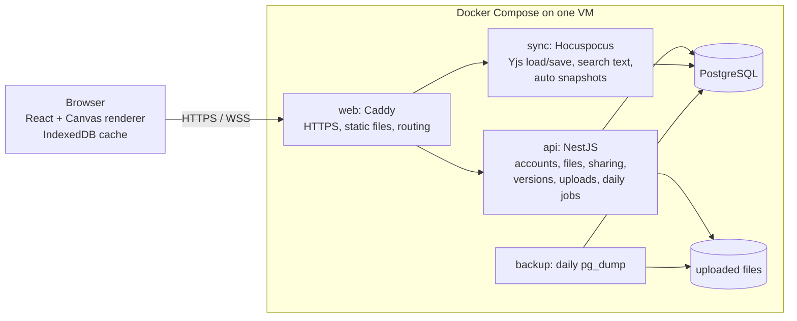

# TinyCanvas

A fast, self-hosted whiteboard for flowcharts and wireframes.

TinyCanvas gives you an infinite canvas where flowcharts, wireframes, text, tables and images live side by side. Default styles look good out of the box, objects snap into alignment, and most actions have a keyboard shortcut, so you spend your time on the diagram rather than on formatting. It runs on a single VM with Docker Compose. It needs no external services: no CDN, no third-party fonts, no email, no telemetry.

Built for personal use: each account has its own private space. There are no teams, roles or billing.

## Features

### Canvas

- Infinite canvas with smooth pan and zoom (10%–400%), trackpad gestures, scrollbars, minimap, "zoom to fit" and "zoom to selection"
- Dot grid with snapping, smart alignment guides and equal-spacing hints
- Select, multi-select and marquee select; move, resize and rotate
- Groups (nested groups too), layering, locking, duplicate with a placement preview
- Align and distribute toolbar for multi-selections
- Copy a selection to the clipboard as a transparent PNG and paste it straight into other apps
- Copy and paste styles between objects
- Undo and redo that cover only your own actions in the current tab
- Renderer built for large boards: viewport culling, a spatial index, layer caching and level-of-detail drawing keep 5,000 objects at 60 fps

### Flowcharts

- About 20 shapes: rectangle, rounded rectangle, ellipse, diamond, parallelogram, cylinder, document, hexagon, triangle, cloud, person and more
- One-click appearance: filled, outline or dashed outline, with an optional transparent background, and a 15-color palette plus custom colors
- Lucide icons inside shapes (above, below, left or right of the text), or as standalone icons on the canvas, searchable by name
- Connectors: straight, elbow (orthogonal, with obstacle avoidance) and curved. Arrowheads, solid or dashed lines and text labels are all supported
- Drag elbow segments to set a manual route; connectors re-route automatically when shapes move
- Hover a shape to reveal connection points: drag one to connect, drop on empty space to create the next shape, or click one to extend the flow in that direction
- Automatic layout (top-to-bottom or left-to-right) powered by ELK

### Wireframes

- About 40 low-fidelity UI components: buttons, inputs, selects, checkboxes, radios, switches, sliders, tabs, navigation bars, cards, tables, avatars, modals, and more
- Device frames for phone, tablet, desktop browser and desktop window
- Wireflows: connect a component to another screen to show navigation

### Text and tables

- Rich text in shapes, text objects, wireframes and table cells
- 12 text sizes, bold, italic, strikethrough, inline code, highlight, links and text color
- Headings, bulleted, numbered and checklist items, and code blocks, with Markdown shortcuts (`#`, `*`, `1.`, `[]`, ` ``` `)
- Tables with resizable columns, header rows, and row and column insert and delete
- Images: upload or paste PNG, JPG, GIF, WebP and SVG

### Files, saving and history

- Folder tree, recent files, favorites, and "tabbed" folders that switch between their files as tabs
- Search file names and canvas content (Mod+K), including short Chinese queries
- Trash with 30-day retention
- Everything saves automatically. The same board stays consistent across tabs and devices
- Keep editing through a dropped connection: changes are cached locally and merged on reconnect
- Version history: automatic snapshots, named versions, preview, restore (undoable), and "save as copy"
- Read-only share links with optional password and expiry, revocable at any time. Viewers don't need an account
- Export the whole board or a selection as PNG (1x or 2x, white or transparent background)

### Interface

- English (default) and Traditional Chinese, switchable from the sidebar
- Keyboard-first: single-key tools (`R`, `O`, `T`, `L`, `W`, `I`), a command palette (`/`), and a shortcut reference (`Mod+/`). Mod is Cmd on macOS and Ctrl elsewhere
- Chinese input methods (Zhuyin, Cangjie) work in every text field on the canvas
- Self-hosted Noto Sans TC variable font, loaded in subsets on demand, so the canvas, the text editor and exported images lay out text identically

## Tech stack

| Layer | Choice |
| --- | --- |
| Monorepo | pnpm workspaces + Turborepo |
| Frontend | React 18, TypeScript, Vite, Radix UI, Tailwind CSS, Lucide |
| Canvas | Custom Canvas 2D renderer (no React dependency) |
| Data and sync | Yjs (CRDT), y-indexeddb, Hocuspocus |
| Rich text | Tiptap (ProseMirror) + y-prosemirror |
| Auto layout | ELK.js |
| API | Node.js 22, NestJS, Prisma |
| Database | PostgreSQL 16 (with `pg_trgm` for search) |
| Auth | Email and password (argon2), HttpOnly cookie sessions, CSRF tokens |
| Deployment | Docker Compose + Caddy (automatic HTTPS) |
| Tests | Vitest, Playwright |

## Architecture



Every board is a Yjs document. The sync service loads it from PostgreSQL and writes it back, which is what keeps multiple tabs in sync and lets offline edits merge cleanly. The same document format will support real-time collaboration later without a migration.

### Repository layout

```
apps/
  web/            React frontend (Vite)
  api/            NestJS REST API, CLI and daily jobs
  sync/           Hocuspocus sync service
packages/
  canvas-engine/  rendering, spatial index, hit testing, interactions, containers
  shared/         types, zod schemas and constants shared by frontend and backend
  db/             Prisma schema, migrations and client
  editor/         Tiptap extensions for rich text on the canvas
  layout/         ELK auto layout
  ui/             Radix + Tailwind components and UI strings (en, zh-TW)
deploy/           Caddyfile and backup image
scripts/          restore.sh and maintenance scripts
docs/             specification, progress and design decisions (Traditional Chinese)
e2e/              Playwright end-to-end tests
```

## Getting started (development)

Requirements: Node.js 22.12+, pnpm 9 (`corepack enable`), and Docker.

```sh
pnpm install
cp dev.env.example dev.env                       # development settings (not committed)
git config core.hooksPath .githooks              # run checks before every push
docker compose -f docker-compose.dev.yml up -d   # PostgreSQL only, on port 54329
pnpm db:generate
pnpm db:deploy                                   # apply migrations (DATABASE_URL comes from dev.env)
pnpm dev                                         # web :5273, api :3000, sync :4000
```

Open http://localhost:5273. Sign-up is enabled in development, or create an account from the CLI:

```sh
pnpm --filter @tinycanvas/api cli create-user --email you@example.com
```

Development settings are in `dev.env`, copied from `dev.env.example`. It is ignored by git so local changes stay local. The `SESSION_SECRET` in the template is a placeholder for local use only; generate a real one with `openssl rand -hex 32` for anything beyond your own machine.

## Testing

| Command | What it runs |
| --- | --- |
| `pnpm check` | Lint, typecheck and unit tests. The pre-push hook runs this |
| `pnpm test:e2e` | Playwright end-to-end tests, including multi-tab consistency. Uses its own database and ports and starts all three services |
| `pnpm perf` | Canvas performance benchmark. Run it on a machine with a display (headed Chrome) |

The API and sync integration tests use the `tinycanvas_test` and `tinycanvas_test_sync` databases in the development PostgreSQL container.

## Deployment

Recommended VM: 2 vCPU, 4 GB RAM, 40 GB SSD, Ubuntu 24.04, Docker Engine with the Compose plugin. Only ports 80 and 443 are exposed.

```sh
git clone <repo-url> tinycanvas && cd tinycanvas
cp .env.example .env              # fill in the required values below
docker compose up -d --build      # migrations run automatically when the API starts
docker compose exec api node dist/cli.js create-user --email you@example.com
```

Check `<PUBLIC_URL>/api/healthz`. It should return `{"status":"ok"}`.

| Variable | Required | Description |
| --- | --- | --- |
| `DOMAIN` | yes | Domain Caddy serves, e.g. `canvas.example.com`. Use `:80` on a LAN without a domain |
| `PUBLIC_URL` | yes | URL users open, e.g. `https://canvas.example.com` or `http://192.168.1.10` |
| `POSTGRES_PASSWORD` | yes | Database password |
| `SESSION_SECRET` | yes | At least 32 random bytes, e.g. `openssl rand -hex 32` |
| `ALLOW_SIGNUP` | no | Allow sign-up from the web page (default `false`) |
| `VERSION_RETENTION_DAYS` | no | Days to keep automatic versions; `0` keeps them forever (default) |
| `BACKUP_RETENTION_DAYS` | no | Days to keep backups (default `14`) |
| `TZ` | no | Time zone for the daily backup (03:00) and cleanup jobs (03:30) (default `Asia/Taipei`) |

**Upgrade:** `git pull && docker compose up -d --build`

**Accounts:** sign-up is off by default. Create accounts and reset passwords with the CLI (`create-user`, `reset-password`). TinyCanvas never sends email.

**Backups:** the backup service runs `pg_dump` and archives uploaded files to `./backups` every day. To restore, run `docker compose stop api sync`, then `scripts/restore.sh <date>`, then `docker compose start api sync`. Copy `./backups` somewhere off the VM as well.

## Documentation

The design documents are written in Traditional Chinese:

- [docs/SPEC.md](docs/SPEC.md): full product and technical specification
- [docs/PROGRESS.md](docs/PROGRESS.md): milestone status and test summary
- [docs/DECISIONS.md](docs/DECISIONS.md): implementation decisions and their reasoning

## License

[MIT](LICENSE) © 2026 David Liu
